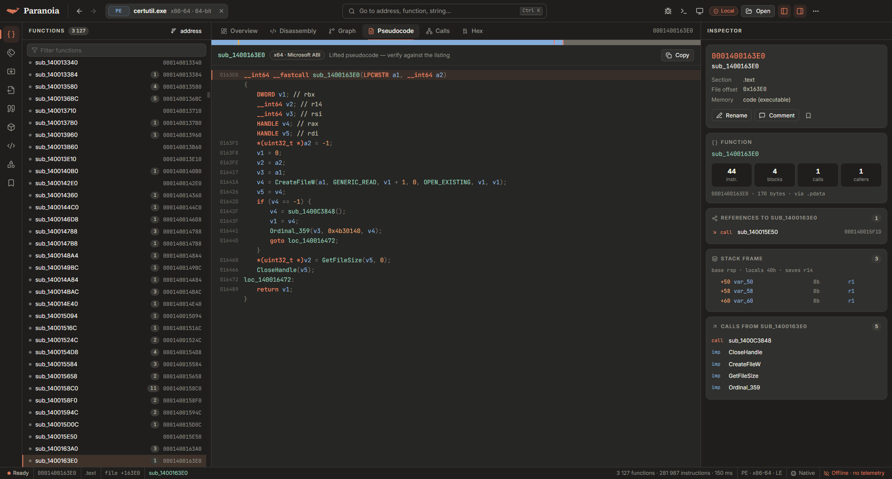

<div align="center">

<picture>
  <source media="(prefers-color-scheme: dark)" srcset="assets/brand/lockup-dark.png" />
  
</picture>

**An open, local-first reverse-engineering platform.**
Disassembly, graphs, a decompiler, debugging and scripting for PE, ELF and Mach-O — in a private desktop app built on Rust.

[](https://github.com/Altumptic/paranoia/actions/workflows/ci.yml)
[](https://github.com/Altumptic/paranoia/releases/latest)
[](LICENSE)

`PSB-C` · `SIGNED` · `ATTESTED` · `SBOM` · `NO-TELEMETRY` · `LOCAL-FIRST` · `AUDIT:NONE` · `DISCLOSURE:OK`
<sub>Altumptic Product Security Baseline labels — what each one means and the evidence: [docs/PSB.md](docs/PSB.md)</sub>

[Download](#install-and-verify) · [Features](#features) · [Security](#security-and-privacy) · [Keyboard](#keyboard) · [Command line](#command-line) · [Build](#build-from-source) · [Roadmap](docs/ROADMAP.md)

</div>

<p align="center">
  
  
</p>
<p align="center">
  
  
</p>

## Why Paranoia

- **Private by design.** No accounts, no telemetry, no network access. Files are analysed on your machine and never uploaded.
- **Fast.** The native Rust engine analyses `shell32.dll` (24 449 functions, 1.47 M instructions) in about two seconds on a mid-range laptop.
- **Built for hostile input.** The engine parses files in its own process, every CI run feeds it 1 500 corrupted PE / ELF / Mach-O files, and a crash never takes the UI down.
- **Verifiable.** Releases come with signed checksums, build-provenance attestations and an SBOM ([how to verify](docs/VERIFY.md)).
- **Open.** Apache-2.0. The same engine powers the desktop app, a CLI and a WebAssembly build that runs in the browser.

## Features

| Area | What you get |
| --- | --- |
| **Formats** | PE / PE32+ (.NET detection, forwarders, TLS callbacks, `.pdata` with chained unwind info), ELF (PIE, PLT/GOT imports, symbol versions), Mach-O (universal binaries, dyld bind opcodes, chained fixups, export trie) |
| **Architectures** | x86 and x86-64 (iced-x86), AArch64, ARM32 and Thumb-2 (yaxpeax-arm), RISC-V RV32/RV64GC and MIPS32/64 (own decoders) |
| **Auto-analysis** | Recursive-descent function discovery from entry points, exports, symbols and exception tables; basic blocks; switch-table recovery; no-return awareness; import thunks |
| **Listing** | Code and data in one view: `sub_` / `loc_` labels, `db/dw/dd/dq`, strings, `offset`, `extrn`, auto names (`aHelloWorld`, `qword_…`), `XREF` comments, jump arrows, argument labels from API prototypes |
| **Decompiler** | x86 / x64 (`Tab` / `F5`): typed variables (`HANDLE v3 = CreateFileW(a1, GENERIC_READ, FILE_SHARE_READ, 0, OPEN_EXISTING, …)`), expression propagation, `switch`, `while` / `for` / `do-while` with `break` / `continue` |
| **Graph & xrefs** | Control-flow graph with pan, zoom and minimap; xrefs dialog (`X`), call graph, stack frames |
| **Editing** | Rename (`N`), comments (`;`), bookmarks, code / data / string / undefine (`C` `D` `A` `U`), create function (`P`), operand display (`H` `R` `B` `M`), local C types, undo / redo — saved per file hash |
| **Hex & patching** | Hex view with data inspector, byte patching, NOP / invert / force-jump patches, save the patched file |
| **Debug info** | PDB symbols (found next to the binary, GUID-checked); DWARF names, globals and source lines |
| **Signatures** | FLIRT-style library recognition with IDA `.pat` files in and out; built-in MSVC x64 runtime library |
| **Debugger** | Windows x64: breakpoints (`F2`), run (`F9`), step into / over (`F7` / `F8`), run to cursor (`F4`), registers and stack |
| **Scripting** | Python in your own interpreter — `import idc, idautils` works for common calls — and JavaScript, both with the `pn` API; headless `paranoia script` batch mode |
| **Triage** | Hashes, entropy map, section map, `checksec`-style mitigations (ASLR, DEP, CFG, RELRO, PIE, canaries, FORTIFY) |

### Current limits

Stated here so nobody has to find them the hard way (full list in the [roadmap](docs/ROADMAP.md)):

- The decompiler covers x86 / x64 only; it does not yet do SSA-based variable recovery or struct member access.
- MIPS support is checked with decoder tests on known encodings, not yet on a full MIPS binary.
- IDA's compressed `.sig` signature files are not read — use `.pat` files.
- The debugger is Windows x64 only.
- Windows executables are not Authenticode-signed yet (see below).

## Install and verify

Download from [Releases](https://github.com/Altumptic/paranoia/releases/latest):

- `Paranoia-Setup-<version>.exe` — Windows installer (per-user, no admin rights)
- `Paranoia-<version>-portable.exe` — single-file portable build
- `SHA256SUMS`, `SHA256SUMS.sigstore.json`, `paranoia-v<version>.cdx.json` — checksums, their signature and the SBOM (from v0.5.1)

The executables are **not Authenticode-signed yet**, so Windows SmartScreen may ask for confirmation on first launch. Check the download instead:

```powershell
Get-FileHash .\Paranoia-<version>-portable.exe -Algorithm SHA256   # compare with SHA256SUMS
```

```bash
cosign verify-blob SHA256SUMS --bundle SHA256SUMS.sigstore.json \
  --certificate-identity-regexp '^https://github\.com/Altumptic/paranoia/\.github/workflows/ci\.yml@refs/tags/v' \
  --certificate-oidc-issuer https://token.actions.githubusercontent.com
gh attestation verify Paranoia-<version>-portable.exe --repo Altumptic/paranoia
```

Step by step: [docs/VERIFY.md](docs/VERIFY.md).

## Security and privacy

- **No network.** The app makes no connections: no telemetry, no update checks, no remote fonts or scripts. Updates are manual.
- **Your data stays local.** Annotations and the recent-files list live in `%APPDATA%\Paranoia`; nothing else is stored ([data inventory](docs/SECURITY-DESIGN.md#data-inventory)).
- **Hardened desktop shell.** Sandboxed renderer with a CSP that forbids `eval`; the JavaScript console runs in an isolated worker; the engine opens only files you chose; starting the debugger or a Python script needs a native confirmation; Electron fuses lock the binary down.
- **Honest scope.** The debugger runs the program you analyse — use a VM for malware. Your Python scripts are ordinary programs. No independent audit has been done yet.

Details: [security design and threat model](docs/SECURITY-DESIGN.md) · [baseline status and exceptions](docs/PSB.md) · report a vulnerability: [SECURITY.md](SECURITY.md).

## Keyboard

| Keys | Action | Keys | Action |
| --- | --- | --- | --- |
| `Ctrl O` | Open file | `Space` | Listing ↔ graph |
| `Ctrl K` / `G` | Go to address, name, string | `Tab` / `F5` | Pseudocode |
| `Esc` / `Alt ←` | Back | `Alt →` | Forward |
| `Enter` / double-click | Follow operand | `X` | Cross references |
| `N` | Rename | `;` | Comment |
| `P` | Create function | `Alt M` / `Ctrl M` | Bookmark / list bookmarks |
| `C` / `D` / `A` / `U` | Code / data / string / undefine | `Ctrl Z` / `Ctrl Y` | Undo / redo |
| `H` / `R` / `B` / `M` | Operand: hex ↔ dec / char / binary / enum | ``Ctrl ` `` | Script console |
| `Alt B` / `Alt T` / `Alt I` | Search bytes / text / immediate | `1`–`6` | Overview, listing, graph, pseudocode, calls, hex |
| `F2` / `F9` / `F7` / `F8` / `F4` | Breakpoint / run / step into / step over / run to cursor | `Ctrl B` / `Ctrl J` | Toggle sidebar / inspector |

## Command line

```bash
paranoia info sample.exe
paranoia functions sample.exe
paranoia disasm sample.exe --at main -n 40
paranoia pseudo sample.exe main
paranoia xrefs sample.exe CreateFileW
paranoia strings --referenced sample.exe --json
paranoia script sample.exe analyse.py --at 140001000   # Python, headless
paranoia sigmake app.exe --pdb app.pdb -o app.pat       # FLAIR .pat from symbols
paranoia sigapply other.exe app.pat
```

## Build from source

Requirements: Rust 1.82+, Node.js 20+.

```bash
# engine + CLI
cargo build --release -p paranoia-engine -p paranoia-cli
cargo test --workspace

# desktop app (dev loop with hot reload)
cd apps/desktop
npm ci
npm run wasm        # engine for the browser build (rustup target add wasm32-unknown-unknown)
npm run app:dev

# Windows installer + portable exe in apps/desktop/out/
npm run dist
```

The browser build (`npm run dev`, then open http://localhost:1420) runs the same engine as WebAssembly in a Web Worker.

> **Windows note.** Everything builds with the `x86_64-pc-windows-gnu` toolchain without a C compiler. If your checkout path contains spaces and you hit `dlltool` errors, set `CARGO_TARGET_DIR` to a path without spaces.

## Repository layout

```
crates/
  paranoia-core     analysis engine: loaders, disassemblers, analysis, decompiler, debug info, signatures
  paranoia-engine   native engine process for the desktop app (JSON over stdio), workspace store, debugger
  paranoia-db       workspace store on redb (annotations, recent files)
  paranoia-wasm     the engine compiled to WebAssembly with a plain C ABI
  paranoia-cli      `paranoia` command-line tool
apps/desktop        React + TypeScript UI, Electron shell, electron-builder packaging
assets/brand        logo and app icon sources
docs/               architecture, security design, verification, baseline status, roadmap
```

## Contributing

Issues and pull requests are welcome — see [CONTRIBUTING.md](CONTRIBUTING.md). Report crashes on specific files with their SHA-256 rather than attaching malware, and report vulnerabilities privately as described in [SECURITY.md](SECURITY.md).

## License

[Apache-2.0](LICENSE).
