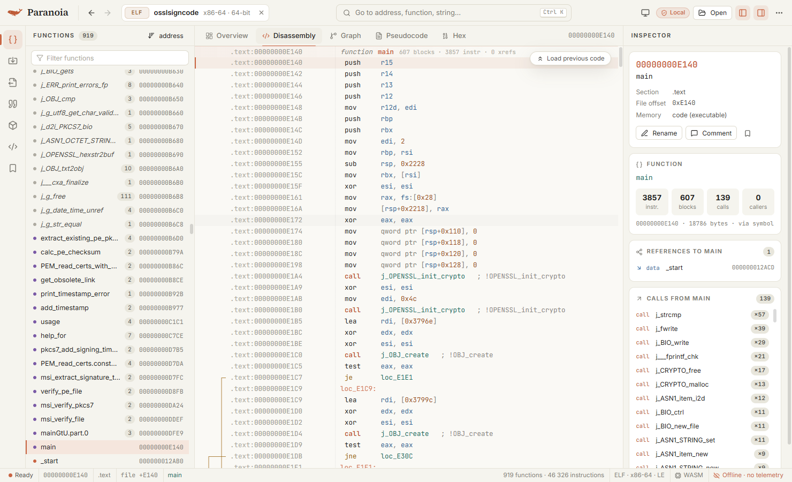
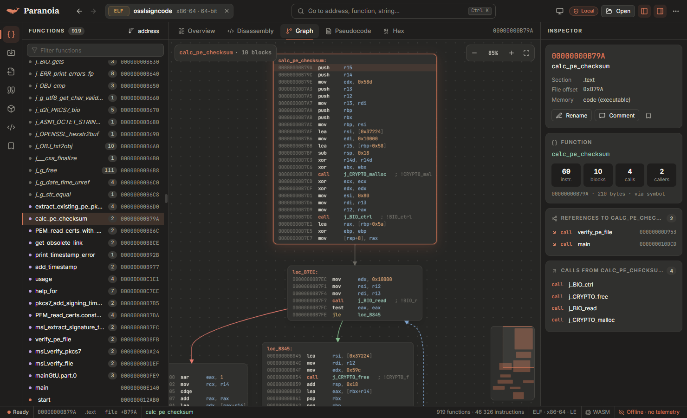
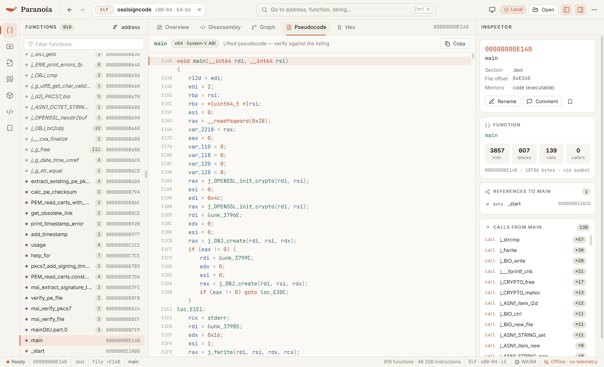
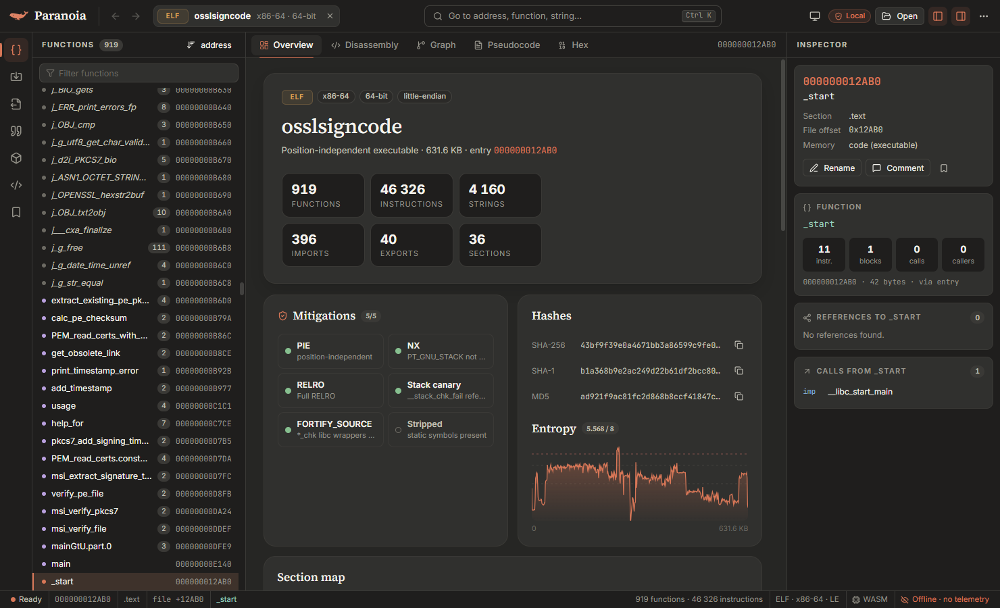

<div align="center">


# Paranoia

**An open, local-first reverse engineering platform.**
Disassembly, control-flow graphs, pseudocode and cross references for PE, ELF and Mach-O — in a fast, private desktop app built on Rust.

[Download](#install) · [Features](#features) · [Keyboard](#keyboard) · [Build from source](#build-from-source) · [Architecture](docs/ARCHITECTURE.md) · [Roadmap](docs/ROADMAP.md)

</div>

<p align="center">
  
  
</p>
<p align="center">
  
  
</p>

## Why Paranoia

- **Private by design.** No accounts, no telemetry, no network access. Binaries are analyzed on your machine and never uploaded.
- **Fast.** A native Rust engine analyzes `shell32.dll` (24 500 functions, 1.5 M instructions) in under half a second.
- **Hardened.** The engine runs in its own process and is fuzzed against corrupted PE / ELF / Mach-O inputs — a hostile file can't take the UI down.
- **Open.** Apache-2.0. The same engine powers the desktop app, a CLI and a WebAssembly build that runs entirely in the browser.

## Features

| Area | What you get |
| --- | --- |
| **Formats** | PE / PE32+ (incl. .NET detection, forwarders, TLS callbacks, `.pdata`), ELF (PIE, PLT/GOT imports, symbol versions), Mach-O (universal binaries, dyld bind opcodes, **chained fixups**, export trie) |
| **Architectures** | x86, x86-64 (iced-x86), AArch64 (yaxpeax-arm, with `adrp`+`add` data references) |
| **Auto-analysis** | Recursive-descent function discovery seeded by entry points, exports, symbols and exception tables; basic blocks; no-return awareness; import thunks (`j_CreateFileW`) |
| **Listing** | IDA-style `sub_`/`loc_` labels, function headers, **jump arrows**, clickable operands, string and import annotations, `align` folding, opcode bytes toggle |
| **Graph** | Control-flow graph with true/false/unconditional edges, GPU-composited pan & zoom, minimap |
| **Pseudocode** | x86 / x64 lifter (F5/Tab): calling-convention arguments, folded conditions, `if { }` and `do { } while` structuring, inline strings, stack variables, intrinsics (`__readgsqword`, `_InterlockedCompareExchange`, …) |
| **Cross references** | Calls, jumps and data references to any address; callees of every function |
| **Names** | MSVC, Itanium C++ and Rust demangling; rename (`N`), comments (`;`), bookmarks (`Alt+M`) — saved per file hash |
| **Search** | Go to anything (`Ctrl+K`), byte patterns with `??` wildcards (`Alt+B`), text in ASCII and UTF-16 (`Alt+T`), immediate values (`Alt+I`) |
| **Hex** | Virtualized hex view with VA/offset mapping, data inspector and **in-place patching**; save the patched file |
| **Triage** | Hashes (MD5, SHA-1, SHA-256, imphash), entropy map, section map, `checksec`-style mitigations (ASLR, DEP, CFG, RELRO, PIE, canaries, FORTIFY, code signing) |
| **Interop** | Create functions (`P`), re-run analysis, export names & comments as an **IDA IDC script** |
| **UI** | Light “ivory” and dark “warm graphite” themes, resizable panels, command palette, drag & drop |

What is *not* here yet — debugger, scripting, type libraries, FLIRT signatures and more — is tracked honestly in the [roadmap](docs/ROADMAP.md).

## Install

Grab the latest build from [Releases](https://github.com/Altumptic/paranoia/releases):

- `Paranoia-Setup-<version>.exe` — Windows installer (per-user, no admin rights)
- `Paranoia-<version>-portable.exe` — single-file portable build

Builds are not code-signed yet, so Windows SmartScreen may ask for confirmation on first launch.

## Keyboard

| Keys | Action | Keys | Action |
| --- | --- | --- | --- |
| `Ctrl O` | Open file | `Space` | Listing ↔ graph |
| `Ctrl K` / `G` | Go to address, name, string | `Tab` / `F5` | Pseudocode |
| `Esc` / `Alt ←` | Back | `Alt →` | Forward |
| `Enter` / double-click | Follow operand | `X` | Cross references |
| `N` | Rename | `;` | Comment |
| `P` | Create function | `Alt M` / `Ctrl M` | Bookmark / list bookmarks |
| `Alt B` / `Alt T` / `Alt I` | Search bytes / text / immediate | `1`–`5` | Overview, listing, graph, pseudocode, hex |
| `Ctrl B` / `Ctrl J` | Toggle sidebar / inspector | `B` | Toggle opcode bytes |

## Command line

```bash
paranoia info sample.exe
paranoia functions sample.exe
paranoia disasm sample.exe --at main -n 40
paranoia pseudo sample.exe main
paranoia xrefs sample.exe CreateFileW
paranoia strings --referenced sample.exe --json
```

## Build from source

Requirements: Rust 1.80+, Node.js 20+.

```bash
# engine + CLI
cargo build --release -p paranoia-engine -p paranoia-cli
cargo test -p paranoia-core

# desktop app (dev loop with hot reload)
cd apps/desktop
npm install
npm run wasm        # engine for the browser build (rustup target add wasm32-unknown-unknown)
npm run app:dev

# Windows installer + portable exe in apps/desktop/out/
npm run dist
```

The browser build (`npm run dev`, then open http://localhost:1420) runs the same engine as WebAssembly in a Web Worker.

> **Windows note.** Everything builds with the `x86_64-pc-windows-gnu` toolchain without a C compiler. If your checkout path contains spaces and you hit `dlltool` errors, set `CARGO_TARGET_DIR` to a path without spaces.

## Repository layout

```
crates/
  paranoia-core     analysis engine: loaders, disassembly, CFG, xrefs, pseudocode, search, patching
  paranoia-engine   native engine process for the desktop app (JSON-RPC over stdio) + workspace store
  paranoia-db       workspace store on redb (annotations, recent files)
  paranoia-wasm     the engine compiled to WebAssembly with a plain C ABI
  paranoia-cli      `paranoia` command-line tool
apps/desktop        React + TypeScript UI, Electron shell, electron-builder packaging
assets/brand        logo and app icon sources
docs/               architecture, roadmap, brand notes
```

## Contributing

Issues and pull requests are welcome — see [CONTRIBUTING.md](CONTRIBUTING.md). Please report crashes on specific files with their SHA-256 rather than attaching malware.

## License

[Apache-2.0](LICENSE). Paranoia Community Edition is and will remain free and open source.
