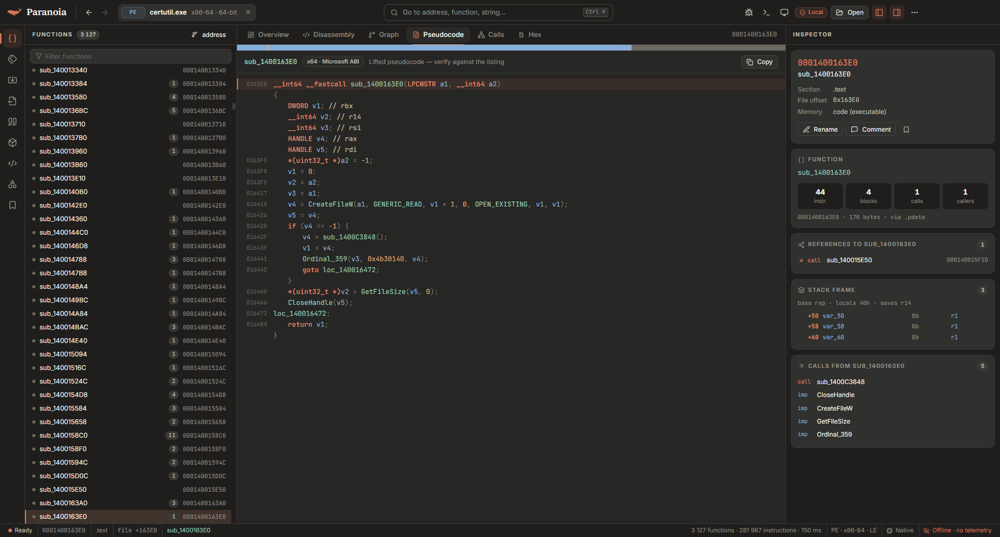
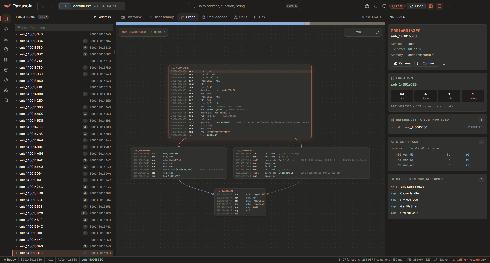
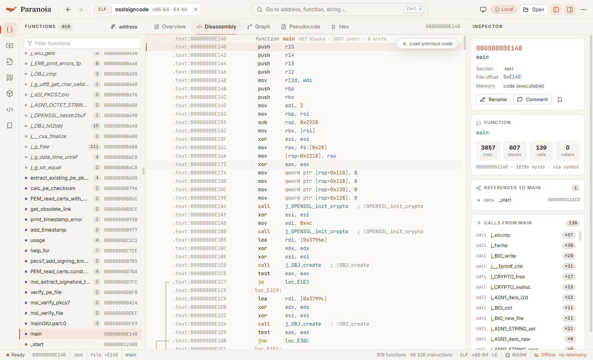
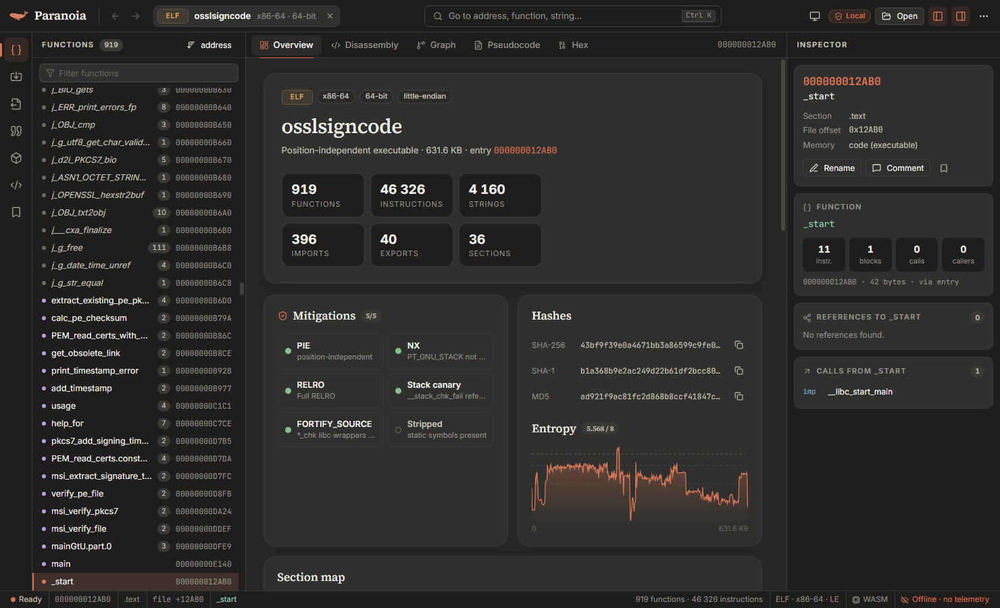

<div align="center">

<picture>
  <source media="(prefers-color-scheme: dark)" srcset="assets/brand/lockup-dark.png" />
  
</picture>

A local-first reverse-engineering tool for PE, ELF and Mach-O.

[](https://github.com/Altumptic/paranoia/actions/workflows/ci.yml)
[](https://github.com/Altumptic/paranoia/releases/latest)
[](LICENSE)

`PSB-C` · `SIGNED` · `ATTESTED` · `SBOM` · `NO-TELEMETRY` · `LOCAL-FIRST` · `AUDIT:NONE` · `DISCLOSURE:OK` ([what these mean](docs/PSB.md))

</div>

<p align="center">
  
  
</p>
<p align="center">
  
  
</p>

Paranoia does disassembly, control-flow graphs, decompilation, debugging and scripting, with keys and scripting names that IDA users will recognise. It remembers the functions you name and recognises them in the next file you open, and it compares two versions of a program function by function. It runs entirely on your machine: no account, no telemetry, no update checks. The engine is written in Rust and the same engine is used by the desktop app, the command-line tool, a browser build (WebAssembly) and an MCP server for AI agents.

## Features

- **Formats:** PE/PE32+ (forwarders, TLS callbacks, `.pdata`, .NET detection), ELF (PIE, PLT/GOT, symbol versions), Mach-O (universal binaries, bind opcodes, chained fixups, export trie).
- **Architectures:** x86, x86-64, AArch64, ARM32/Thumb-2, RISC-V, MIPS, PowerPC.
- **Analysis:** functions from entry points, exports, symbols and unwind tables (so stripped ELF and Mach-O files keep their functions), Go's function table (stripped Go programs keep their functions and names), switch tables, cross references, auto names in the IDA style.
- **Function memory:** compare two binaries (what changed, was added or removed, both versions side by side) and keep a local database of the functions you named, so their names and comments carry over to new versions and related samples — together with the struct types their variables need. Nothing leaves your machine. See [docs/FUNCTION-MEMORY.md](docs/FUNCTION-MEMORY.md).
- **Decompiler:** x86 and x64, with typed variables, API constants, loops and `switch`, struct member access (`Y` on a variable) and types that follow calls. AArch64 is experimental.
- **Measured:** a reproducible benchmark compares the decompiler, symbol recovery and call-name agreement with Ghidra on real binaries, includes the failures and commits the raw results ([docs/BENCHMARK.md](docs/BENCHMARK.md)).
- **Case studies:** three real walk-throughs — a stripped Go binary, an MSVC `/MT` binary and a version diff — with commands and hashes ([docs/CASE-STUDIES.md](docs/CASE-STUDIES.md)).
- **Editing:** rename, comments, bookmarks, define code/data/strings, create functions, local C types, undo and redo. Everything is saved per file hash.
- **Patching:** hex view, byte patches, NOP/invert/force-jump, an x86 assembler, save the patched file.
- **Debug info:** PDB and DWARF names and types, FLIRT signatures (`.sig` and `.pat`), and built-in signature packs for the MSVC static CRT, Rust std and musl libc ([docs/SIGNATURES.md](docs/SIGNATURES.md)).
- **Debugger:** local Windows (x64 and 32-bit) and Linux x86-64 programs.
- **Scripting:** Python in your own interpreter (`idc` and `idautils` work for common calls), JavaScript, plugins, and a headless batch mode.
- **AI:** an optional assistant in the app ([local or hosted model](docs/ASSISTANT.md): Ollama, LM Studio, llama.cpp, Claude, OpenAI, OpenCode and others), and `paranoia mcp` for agents such as Claude Code, which can hide the sample's strings and IP-like numbers from the model and keep a log of everything the agent was shown. The in-app assistant has the same opt-in redaction and keeps a local hash-chained disclosure ledger. See [docs/MCP.md](docs/MCP.md) and [docs/ASSISTANT.md](docs/ASSISTANT.md).

Speed, measured on a Core i5-12450H with a release build: `notepad.exe` is analysed in 45 ms, `shell32.dll` (7.7 MB, 24 449 functions) in about a second.

## Limits

- Pseudocode exists for x86 and x64. AArch64 pseudocode is experimental: types come only from known library calls, and it has been measured on Go binaries only. Other architectures have disassembly and graphs only.
- MIPS has only been tested on known instruction encodings, not on a full binary.
- On a 32-bit PE, functions that nothing calls are found by a scan for prologues and relocation targets, not from an unwind table, so that list is a heuristic: on five system DLLs it agrees with Ghidra's at about 98 % in both directions ([docs/BENCHMARK.md](docs/BENCHMARK.md)).
- The debugger runs local programs only. Remote debugging is planned.
- The desktop app is built for Windows (x64), Linux (x64 and ARM64) and macOS (arm64 and x64). The Linux and macOS packages are new and have had much less testing than the Windows build. The command-line tool (with `diff`, function memory and the MCP server) is released for Windows, Linux and macOS.
- Raw firmware images without a PE/ELF/Mach-O header can't be loaded yet.
- The Windows executables aren't Authenticode-signed yet (SmartScreen may warn), and the macOS app is signed ad-hoc rather than with a Developer ID, so it isn't notarised (Gatekeeper will warn). The checksums, Sigstore signature and attestations cover every platform.

The [roadmap](docs/ROADMAP.md) has the full list.

## Install

Download the file for your system from [Releases](https://github.com/Altumptic/paranoia/releases/latest) and check it against the signed checksums before running it. Every platform is covered by `SHA256SUMS`, its Sigstore signature and the GitHub attestations, even where the OS vendor signature is still missing.

### Windows

`Paranoia-Setup-<version>.exe` (installer) or `Paranoia-<version>-portable.exe`. They aren't Authenticode-signed yet, so SmartScreen may warn on first start.

### Linux

`Paranoia-<version>-linux-x86_64.AppImage` or `Paranoia-<version>-linux-amd64.deb` for x64, and `Paranoia-<version>-linux-arm64.AppImage` or `Paranoia-<version>-linux-arm64.deb` for ARM64. The AppImage is a single file: make it executable and run it. The deb installs the app and a `paranoia` launcher:

```bash
chmod +x Paranoia-<version>-linux-x86_64.AppImage
./Paranoia-<version>-linux-x86_64.AppImage

sudo apt install ./Paranoia-<version>-linux-amd64.deb
```

### macOS

`Paranoia-<version>-mac-arm64.dmg` for Apple Silicon and `Paranoia-<version>-mac-x64.dmg` for Intel Macs; `.zip` archives of the same apps are in the release too. The app is signed ad-hoc rather than with a Developer ID and is not notarised, so Gatekeeper blocks the first launch. After checking the checksum, clear the quarantine flag (the reliable way on every macOS version):

```bash
xattr -dr com.apple.quarantine /Applications/Paranoia.app
```

On macOS versions that still offer it, right-clicking the app in Finder and choosing **Open** has the same effect.

There is no Apple Developer ID yet; if one is added, later releases can be signed and notarised normally ([docs/SIGNING.md](docs/SIGNING.md)).

### Check a download

PowerShell:

```powershell
Get-FileHash .\Paranoia-<version>-portable.exe -Algorithm SHA256   # compare with SHA256SUMS
```

```bash
cosign verify-blob SHA256SUMS --bundle SHA256SUMS.sigstore.json \
  --certificate-identity-regexp '^https://github\.com/Altumptic/paranoia/\.github/workflows/ci\.yml@refs/tags/v' \
  --certificate-oidc-issuer https://token.actions.githubusercontent.com
gh attestation verify Paranoia-<version>-portable.exe --repo Altumptic/paranoia
```

More in [docs/VERIFY.md](docs/VERIFY.md).

The command-line tool for Linux and macOS is in the same release, as `paranoia-cli-<version>-<os>-<arch>.tar.gz` (Linux x64 and ARM64, macOS ARM64 and x64), checked the same way:

```bash
tar -xzf paranoia-cli-v0.9.0-linux-x64.tar.gz
./paranoia-cli-v0.9.0-linux-x64/paranoia --version
```

On macOS, the CLI binary is quarantined too because it isn't notarised; `xattr -d com.apple.quarantine paranoia` clears that after you have checked the checksum.

## Privacy and security

The app makes no network connections. The only exception is the AI assistant, and only after you point it at a server. Your names, comments and recent files are stored in the app's data folder — `%APPDATA%\Paranoia` on Windows, `~/.config/Paranoia` on Linux, `~/Library/Application Support/Paranoia` on macOS — and nowhere else. When you ask the assistant, its request and answer are recorded in a hash-chained `assistant-ledger.jsonl` in that folder, and the file's strings and IP-like numbers can be hidden from the request.

The renderer is sandboxed, the engine runs in its own process and only opens files you chose, and starting the debugger or a Python script asks for confirmation first. The debugger runs the program you're analysing, so use a VM for malware. There has been no independent audit.

Details: [docs/SECURITY-DESIGN.md](docs/SECURITY-DESIGN.md). To report a vulnerability, see [SECURITY.md](SECURITY.md).

## Keys

| Key | Action | Key | Action |
| --- | --- | --- | --- |
| `Ctrl O` | Open file | `Space` | Listing / graph |
| `Ctrl K`, `G` | Go to address or name | `Tab`, `F5` | Pseudocode |
| `Esc`, `Alt ←` | Back | `Alt →` | Forward |
| `Enter` | Follow operand | `X` | Cross references |
| `N` | Rename | `;` | Comment |
| `Y` | Type a variable | `Alt M`, `Ctrl M` | Bookmark, list bookmarks |
| `P` | Create function | `Ctrl Z`, `Ctrl Y` | Undo, redo |
| `C` `D` `A` `U` | Code, data, string, undefine | ``Ctrl ` `` | Script console |
| `H` `R` `B` `M` | Hex/decimal, char, binary, enum | `1`–`6` | Switch view |
| `Alt B` `Alt T` `Alt I` | Search bytes, text, immediate | `Ctrl B`, `Ctrl J` | Sidebar, inspector |
| `F2` `F9` `F7` `F8` `F4` | Breakpoint, run, step into, step over, run to cursor | | |

## Command line

```bash
paranoia info sample.exe
paranoia functions sample.exe
paranoia disasm sample.exe --at main -n 40
paranoia pseudo sample.exe main
paranoia xrefs sample.exe CreateFileW
paranoia strings --referenced sample.exe --json
paranoia script sample.exe analyse.py      # run a Python script without the app
paranoia sigapply app.exe libc.sig         # IDA .sig or .pat signatures
paranoia diff old.exe new.exe              # which functions changed between two versions
paranoia memory learn sample-a.exe         # remember the names you gave in the app
paranoia memory recall sample-b.exe        # recognise them in another file
paranoia mcp --root ./samples              # MCP server for AI agents
paranoia query sample.exe inventory        # JSON for other tools (docs/QUERY.md)
```

## Building

You need Rust 1.88+ and Node.js 20+. CI builds with Rust 1.94.1, pinned so that a new compiler's lints can't break a build on their own; the pin is moved on purpose.

```bash
cargo build --release -p paranoia-engine -p paranoia-cli
cargo test --workspace

cd apps/desktop
npm ci
npm run app:dev     # app with hot reload
npm run dist        # Windows installer and portable exe in apps/desktop/out/ (alias for dist:win)
npm run dist:linux  # AppImage and .deb, built on Linux
npm run dist:mac    # .dmg and .zip for the host architecture, built on macOS
```

On Windows everything builds with the `x86_64-pc-windows-gnu` toolchain, no C compiler needed. If the checkout path has spaces in it and you get `dlltool` errors, set `CARGO_TARGET_DIR` to a path without spaces.

The Linux and macOS packages are built by the release workflow on their own operating systems, one architecture per job; electron-builder does not cross-compile the desktop app. The Linux engine is static (musl), like the CLI, so it does not depend on the build machine's glibc. These platforms are new to the release pipeline: no tagged release had been built with them when this was written, so the first tag run is the proof.

```
crates/paranoia-core     the engine: loaders, disassemblers, analysis, decompiler
crates/paranoia-engine   engine process for the desktop app, workspace store, debugger
crates/paranoia-cli      the `paranoia` command
crates/paranoia-db       workspace store (redb)
crates/paranoia-wasm     the engine as WebAssembly
apps/desktop             React UI and Electron shell
```

See [CONTRIBUTING.md](CONTRIBUTING.md) before sending a pull request, and [docs/ARCHITECTURE.md](docs/ARCHITECTURE.md) for how the pieces fit.

## License

[Apache-2.0](LICENSE)
