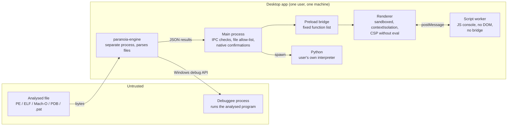

# Security design

Paranoia is a reverse-engineering tool: its job is to open files that may be hostile. This note describes what it trusts, what it defends against, what it deliberately does not protect, and where the known limits are. It is written to the [Altumptic Product Security Baseline](PSB.md) (product class **PSB-C**, local-first tooling).

**Independent audit:** none yet (`AUDIT:NONE`). Everything below is the maintainers' own design and testing.

## Trust boundaries

| Component | Trusted with | Not trusted with |
| --- | --- | --- |
| **Analysed files** | nothing | everything — every size, offset, name and table is treated as hostile |
| **Engine** (`paranoia-engine`, Rust) | parsing and analysis | it runs in its own process; if it crashes the app restarts it, and a crash never takes the UI with it |
| **Renderer** (React UI) | showing results | no Node.js, no file system, no network; it can only call the preload functions |
| **Script worker** (JS console) | the user's own JavaScript | it has no DOM and no bridge; it reaches the engine only through `pn` requests the page forwards for the open file |
| **Main process** (Electron) | file dialogs, starting processes | it accepts requests only from the app's own top-level page and limits them as described below |
| **Python** | the user's own scripts | Python is a normal program with the user's permissions — see non-goals |
| **Debuggee** | nothing | it is the program being analysed, running for real |

## Threats and mitigations

| Threat | Mitigation | Evidence |
| --- | --- | --- |
| A crafted file crashes the engine or corrupts memory | Rust with no `unsafe` in the parsers; own bounds-checked parsers where third-party ones panicked (`.pdata`, Mach-O binds, export trie); hard limits on functions and instructions; panics are caught per request; the engine is a separate process | `cargo test` (fuzz tests on random bytes for every decoder; type and `.pat` parsers); `tests/real_binaries.rs` mutates real PE / ELF / Mach-O samples (CI: 500 mutants per OS, release checks: 18 000 across PE, RISC-V ELF and AVR ELF) |
| A crafted file makes the engine hang | Analysis limits per function and per file; decompiler passes are linear-pass with bounded rounds | Bulk runs over every function of kernel32, shell32 and notepad finish in seconds |
| Text from the file (names, strings) runs script in the window | React renders text, never HTML; the page CSP is `script-src 'self' 'wasm-unsafe-eval'` without `'unsafe-eval'` or inline scripts; the JS console runs in a separate worker | CSP in `electron/main.cjs` and `vite.config.ts` |
| A compromised renderer reads arbitrary files | The engine opens only files the user chose (file dialog, command line, drag and drop, recent list); exports and text files are written only to the path picked in the last save dialog | `pathAllowed` / `lastSavePath` in `electron/main.cjs` |
| A compromised renderer runs programs | Starting the debugger and running Python both require a **native** confirmation shown by the main process; the page cannot answer it | `engine:request` and `python:run` handlers |
| Another frame sends IPC messages | Every handler checks that the sender is the app's own top-level page; `<webview>`, pop-ups and navigation are blocked; all permission requests are denied | `trusted()` in `electron/main.cjs` |
| Electron or Node.js used as a launcher for other code | Electron fuses: `RunAsNode`, `NODE_OPTIONS` and `--inspect` disabled; the app loads only from its asar archive, whose integrity is checked | `build.electronFuses` in `apps/desktop/package.json` |
| Python picks up planted modules | Each run uses a fresh private temporary directory; the interpreter runs with `-E` (ignores `PYTHONPATH`, `PYTHONSTARTUP`, …) and starts in that empty directory, so a stray `python.exe` or module in the current folder is not used | `electron/python.cjs`, `crates/paranoia-cli/src/script.rs` |
| A tampered download | Every release ships `SHA256SUMS`, its Sigstore signature, GitHub build-provenance attestations and an SBOM | [VERIFY.md](VERIFY.md) |
| A vulnerable dependency | `cargo audit` and `npm audit` run in CI and block releases; actions are pinned to commit SHAs; Dependabot proposes updates | `.github/workflows/ci.yml` |

## Non-goals

Paranoia does **not** protect against the following. Use a virtual machine for these cases.

- **Running malware.** The debugger starts the analysed program for real, with your permissions. A native warning says so every time.
- **Your own scripts.** Python and JavaScript console scripts are your code. Python has full access to your files and network, like any program you run. The JavaScript console is contained in a worker, but it can still change the open file's annotations and patches.
- **A compromised machine or user account.** Another program running as you can read Paranoia's data or modify its files.
- **Anti-analysis tricks.** Obfuscated or packed code can mislead the disassembler, the decompiler and the signatures. The results are an aid for a human analyst, not a verdict.
- **Confidentiality of what you analyse from other local users of the same account.**

## Cryptography and hashes

Paranoia does not encrypt anything and has no accounts, keys or secrets.

| Use | Algorithm | Notes |
| --- | --- | --- |
| Identity of an analysed file (annotation storage) | SHA-256 | |
| File hashes shown to the user | SHA-256, SHA-1, MD5, imphash (MD5) | **Identification only** — shown so results match other tools and threat-intel feeds. Not used for any security decision. |
| Release integrity | SHA-256 (`SHA256SUMS`), Sigstore keyless signature (ECDSA P-256 Fulcio certificate bound to the release workflow), GitHub attestations | See [VERIFY.md](VERIFY.md) |
| Signature recognition (FLIRT `.pat`) | CRC-16 | Pattern matching, not integrity |

## Network

The app and the engine make **no network connections**: no telemetry, no update checks, no crash reports, no fonts or scripts from CDNs. The page CSP restricts connections to the app itself (`connect-src 'self'`). The only programs that can reach the network are your own Python scripts and, in the JavaScript console, your own code inside the script worker.

Updates are manual: download a new release and verify it ([VERIFY.md](VERIFY.md)). There is no auto-updater.

## Data inventory

Everything stays on your machine.

| Data | Where | Why | Kept until |
| --- | --- | --- | --- |
| Annotations (names, comments, types, bookmarks, patches) per file | `%APPDATA%\Paranoia\workspace.redb` (desktop) · browser `localStorage` (web build) | so your work survives a restart | you delete the file / clear site data |
| Recent files: name, **full path**, SHA-256, format, size, time | same database | the start screen list | removed from the list, or the database deleted |
| UI preferences, console scripts | Electron / browser `localStorage` | convenience | cleared with the app data |
| Python run files (`paranoia.py`, `script.py`) | a fresh `%TEMP%\paranoia-py-*` folder | to run the script | deleted when the script ends |

To remove everything: close Paranoia and delete `%APPDATA%\Paranoia` (Windows). The analysed files themselves are never copied.

## Operating-system permissions

The app needs no administrator rights and requests no camera, microphone, location or notification access (all such requests are denied). The installer is per-user. The debugger uses the Windows debugging API (`CreateProcess` with `DEBUG_ONLY_THIS_PROCESS`) on a program you start from the app; it does not attach to other processes.

## Known limits

- **Windows executables are not Authenticode-signed yet.** Verify downloads with `SHA256SUMS`, its Sigstore signature and the attestations ([VERIFY.md](VERIFY.md)). Tracked as exception PSB-EX-1 in [PSB.md](PSB.md).
- The page CSP keeps `'wasm-unsafe-eval'` (WebAssembly compilation for the browser build) and Electron's extra `file://` privileges (needed for the app's workers). Both are tracked as exceptions in [PSB.md](PSB.md).
- Builds are not reproducible bit-for-bit yet; provenance attestations tie each file to the workflow run that built it.
- No independent security audit has been performed.
- The JavaScript console worker is not a security boundary against your own code (see non-goals).
