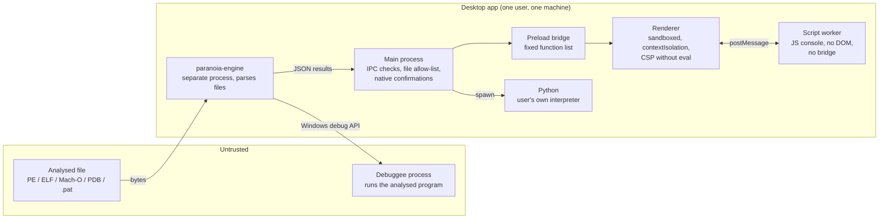

# Security design

Paranoia exists to open files that may be hostile. This page says what it trusts, what it protects against, what it doesn't, and where the known gaps are. It follows the [Altumptic Product Security Baseline](PSB.md), class PSB-C (local-first tools).

There has been no independent audit (`AUDIT:NONE`). Everything here is our own design and testing.

## Trust boundaries

| Component | Trusted to | Not trusted to |
| --- | --- | --- |
| Analysed file | nothing | anything. Every size, offset, name and table is treated as hostile |
| Engine (`paranoia-engine`) | parse and analyse | stay up. It runs in its own process, and if it crashes the app restarts it |
| Renderer (React UI) | show results | touch Node.js, files or the network. It can only call the preload functions |
| Script worker (JS console) | run the user's JavaScript | reach the DOM or the bridge. It only gets `pn` requests forwarded for the open file |
| Main process (Electron) | show file dialogs, start processes | take requests from anything but the app's own top-level page |
| Python | run the user's scripts | be contained. It's a normal program with the user's permissions |
| Debuggee | nothing | anything. It is the analysed program, running for real |
| MCP client (an agent using `paranoia mcp`) | ask questions about files under `--root` | open other files, use the network, change the analysed file. Writes need `--allow-writes` |

## Threats

| Threat | What we do | Where to check |
| --- | --- | --- |
| A crafted file crashes the engine | No `unsafe` in the parsers; our own bounds-checked parsers where third-party ones panicked (`.pdata`, Mach-O binds, export trie, `.eh_frame_hdr`); hard limits on functions and instructions; panics caught per request; the engine is a separate process | Random-input tests for every decoder; `tests/real_binaries.rs` corrupts real PE, ELF and Mach-O files (500 per OS on CI, 18 000 before a release) |
| A crafted file makes the engine hang | Limits per function and per file; decompiler passes run a bounded number of rounds | Full runs over kernel32, shell32 and notepad finish in seconds |
| Names or strings from the file run script in the window | React renders text, never HTML; the CSP is `script-src 'self' 'wasm-unsafe-eval'`, with no `'unsafe-eval'` and no inline scripts; the JS console runs in a worker | CSP in `electron/main.cjs` and `vite.config.ts` |
| A compromised renderer reads other files | The engine only opens files the user chose (dialog, command line, drag and drop, recent list). The page can't add a path to the recent list unless it was opened this session, and it gets only a fixed set of store methods. Each save dialog allows exactly one write, and "show in folder" only works for opened or saved files | `pathAllowed`, `takeSavePath` in `electron/main.cjs`; `policy.cjs` with `policy.test.cjs` |
| A compromised renderer runs programs | The debugger and Python need a native confirmation from the main process, which the page can't click. The debugger dialog shows the program and the command-line arguments, since the page supplies the arguments | `engine:request` and `python:run` handlers |
| Another page gets the bridge | Only the app's own `index.html` counts as trusted: navigating to any other `file://` page (or anywhere else) is blocked, and IPC from it is refused. External links open in the browser only for a short list of https hosts | `isOwnPage`, `policy.isAppPage`, `policy.externalAllowed` |
| Another frame sends IPC messages | Every handler checks the sender is the app's own main frame; webviews, pop-ups and navigation are blocked; permission requests are denied | `trusted()` in `electron/main.cjs` |
| Electron used to launch other code | Fuses turn off `RunAsNode`, `NODE_OPTIONS` and `--inspect`; the app loads only from its asar archive, which is integrity-checked | `build.electronFuses` in `apps/desktop/package.json` |
| Python picks up planted modules | Each run uses a fresh temp folder and `python -E`, starting in that empty folder | `electron/python.cjs`, `crates/paranoia-cli/src/script.rs` |
| A compromised renderer misuses the knowledge base | The page gets four methods (stats, learn, recall, forget) and no file paths; export and import exist only in the CLI | `policy.memoryMethodAllowed` |
| An agent asks the MCP server for files outside the samples folder | `open_binary` resolves the path, symlinks included, and refuses anything outside `--root`; no other tool takes a path | `files_outside_the_roots_are_refused` in `mcp.rs` |
| Strings in a sample try to instruct the agent | The server tells the client that file content is data; write tools are off by default; `--redact-strings` keeps strings from the model. Whether a model obeys injected text is outside our control | `handshake_and_tool_list`, `redaction_and_ledger` in `mcp.rs` |
| A crafted file crashes the MCP server | Each tool call is guarded and returns an error instead; output is capped at 60 000 characters | `mcp.rs` |
| A tampered download | Each release has `SHA256SUMS`, a Sigstore signature, build provenance attestations and an SBOM | [VERIFY.md](VERIFY.md) |
| A vulnerable dependency | `cargo audit` and `npm audit` block releases (one accepted packaging-tool advisory, PSB-EX-4); actions pinned to commit hashes; Dependabot | `.github/workflows/ci.yml` |

## Not covered

Use a virtual machine for these:

- Running malware. The debugger starts the analysed program for real, with your permissions. You get a warning every time.
- Your own scripts. Python scripts have full access to your files and network. The JavaScript console is contained in a worker but can still change annotations and patches.
- A compromised machine or account. Another program running as you can read and change Paranoia's data.
- Anti-analysis tricks. Packed or obfuscated code can mislead the disassembler, the decompiler and the signatures.
- Other local users of the same account seeing what you analyse.

## Hashes and crypto

Paranoia doesn't encrypt anything and has no accounts or keys of its own.

| Use | Algorithm | Notes |
| --- | --- | --- |
| Identifying a file for its annotations | SHA-256 | |
| Hashes shown to the user | SHA-256, SHA-1, MD5, imphash | Only for matching other tools and threat feeds, never for a security decision |
| Release integrity | SHA-256, Sigstore keyless signature, GitHub attestations | [VERIFY.md](VERIFY.md) |
| FLIRT signatures | CRC-16 | Pattern matching, not integrity |

## Network

The app and the engine make no network connections by themselves: no telemetry, crash reports, fonts or scripts from CDNs, and nothing at start-up. The page CSP limits connections to the app itself. What can reach the network: your own Python scripts, your own code in the script worker, the AI assistant once you've set it up, and the update check when you press its button.

### Update check

`Help → Check for updates…` opens a dialog that says what will happen; only **Check now** sends anything. The main process (never the page) makes one `GET https://api.github.com/repos/Altumptic/paranoia/releases/latest` with `credentials: omit` and a fixed `User-Agent`, so not even the app's version is sent. The answer is limited to 1 MB and reduced to the tag, the date and a link; the link is rebuilt from the tag and the answer is refused if its `html_url` is anything else, so a changed or hostile answer cannot put another address in front of the user. Pre-release candidates are never offered (GitHub's `latest` skips them). Nothing is downloaded or installed: the release page opens in the browser (github.com is already on the external-link allow-list). Covered by `electron/update.test.cjs`.

There's no auto-updater and no background check. Download new releases yourself and check them ([VERIFY.md](VERIFY.md)). Silent updates need platform code signing first ([SIGNING.md](SIGNING.md)); an updater that installs unsigned code on its own would weaken the verifiable chain.

### AI assistant

`Assistant → Settings…` takes an endpoint, a model and an optional API key. There are presets for local servers (Ollama, LM Studio, llama.cpp, Jan, vLLM) and hosted ones (Claude, OpenAI, OpenCode, DeepSeek, Kimi, Gemini, Mistral, Grok, Groq, Together, OpenRouter). **Load models** sends only the API key (to `GET /models`) and **Test** a fixed one-line prompt; both work only for a host already allowed. Nothing is sent until an endpoint is set. Requests come from the main process, not the page, and contain only the pseudocode of the function you asked about (up to 12 000 characters). No file bytes, hashes or other functions. Two opt-in privacy options in the same settings hide the file's strings (`<str#N len=L>`, `aRedactedN`) and IP-like numbers (`<ip#N>`) from the request before it leaves the main process. Every request and answer is recorded in a hash-chained `assistant-ledger.jsonl` in the data folder — host, task, model, redaction counts and the request/response SHA-256, never the code or the answer — and a request is withheld if that line cannot be written.

- Changing the endpoint needs a native confirmation, so the page can't redirect the assistant. Only `localhost`, `127.x.x.x` and `::1` count as local; names like `ai.localhost` don't, because DNS could send them anywhere. Anything else has to be `https://` and is confirmed when you save it and again before the first request of each session.
- Redirects are refused, replies are capped at 256 KB, requests time out after 300 s.
- The API key is encrypted with the OS keystore (`safeStorage`) and never sent to the page. If the OS can't encrypt, the key is only kept in memory.
- Answers are shown as text. A suggested name is only applied when you click it, and must be a plain C identifier.

### MCP server

`paranoia mcp` is a separate program the user starts, not part of the desktop app. It talks JSON-RPC over stdin and stdout and opens no sockets. It only opens files under `--root`, and write tools only exist with `--allow-writes`. `--redact-strings` replaces the file's strings with placeholders in every answer, `--redact-ips` does the same for IPv4/IPv6 literals, and both are counted in the ledger. `--ledger FILE` writes each answer to a local file before sending it and holds the answer back if that fails. `--workspace` reads the app's annotations for the file and, with `--allow-writes`, saves changes back; it can't open the store while the app holds it, and a failed save undoes the change.

The agent's client decides where the answers go. With a hosted model, the pseudocode and strings the agent reads leave the machine through that client. See [MCP.md](MCP.md).

## Data stored

Everything stays on your machine. The data folder is `%APPDATA%\Paranoia` on Windows, `~/.config/Paranoia` on Linux and `~/Library/Application Support/Paranoia` on macOS.

| Data | Where | Why | Until |
| --- | --- | --- | --- |
| Annotations per file (names, comments, types, bookmarks, patches) | the data folder's `workspace.redb`, or `localStorage` in the browser build | Keep your work across restarts | You delete it |
| Installed plugins and the versions you chose to always run (fingerprints only) | the data folder's `plugins` | Keep commands; ask again when a plugin changes | You delete it |
| Function knowledge base: names, comments and variable names you chose to remember, with code fingerprints and the name and SHA-256 of each source file | the data folder's `memory.redb` | Recognise known functions in other files | You remove it (`paranoia memory forget`, or delete the file) |
| AI assistant settings, API key encrypted | the data folder's `ai-settings.json` | Keep the assistant set up | You clear it |
| AI assistant disclosure ledger: host, task, model, redaction counts, request/response SHA-256 | the data folder's `assistant-ledger.jsonl` | Show what the assistant sent | You delete the file |
| Recent files: name, full path, SHA-256, format, size, time | the workspace database | The start screen | You remove it |
| UI preferences, console scripts | `localStorage` | Convenience | Cleared with app data |
| MCP ledger: each answer given to an agent, with hashes | the file given to `--ledger` | A record of what an agent saw | You delete it |
| Python run files | a fresh `%TEMP%\paranoia-py-*` folder | Running the script | Deleted when it ends |

To remove everything, close Paranoia and delete `%APPDATA%\Paranoia`. Analysed files are never copied.

## OS permissions

No administrator rights. Requests for camera, microphone, location or notifications are denied. The installer is per-user. The Windows debugger starts the program itself (`DEBUG_ONLY_THIS_PROCESS`) and never attaches to other processes.

## Known gaps

- The Windows executables aren't Authenticode-signed yet. Use the checksums, signature and attestations instead (PSB-EX-1).
- The CSP allows `'wasm-unsafe-eval'` for the browser build, and Electron's extra `file://` privileges are still on (PSB-EX-2, PSB-EX-3).
- Builds aren't bit-for-bit reproducible. The provenance attestations tie each file to the CI run that built it.
- No independent audit yet.
- The JavaScript console worker isn't a boundary against your own code.
